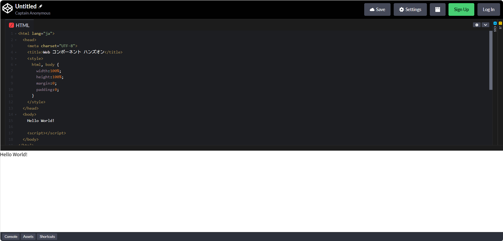
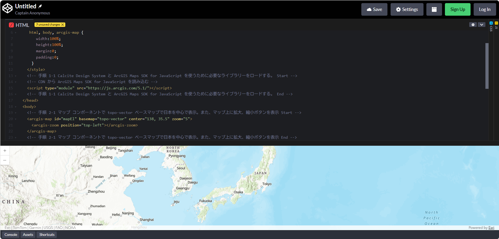
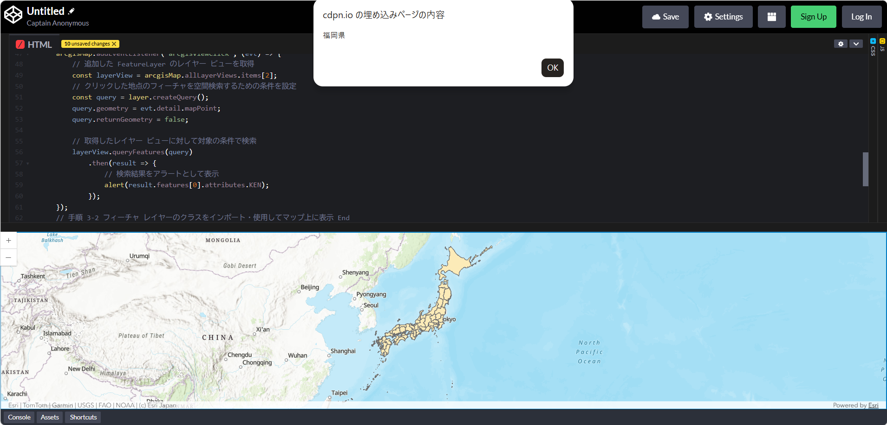
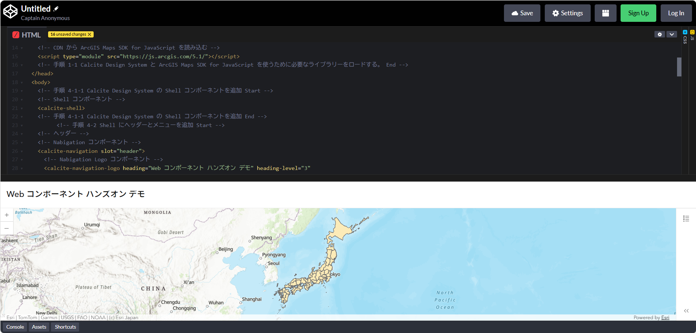
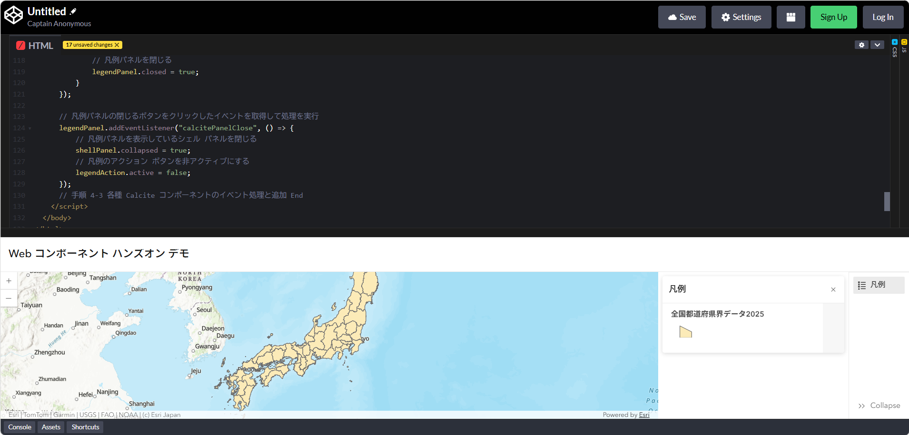
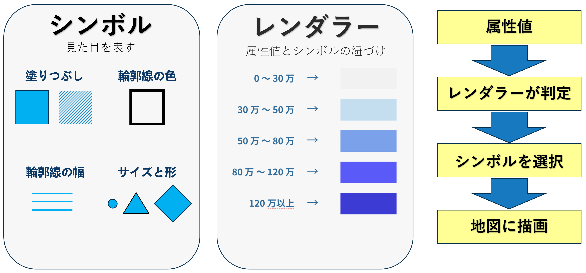
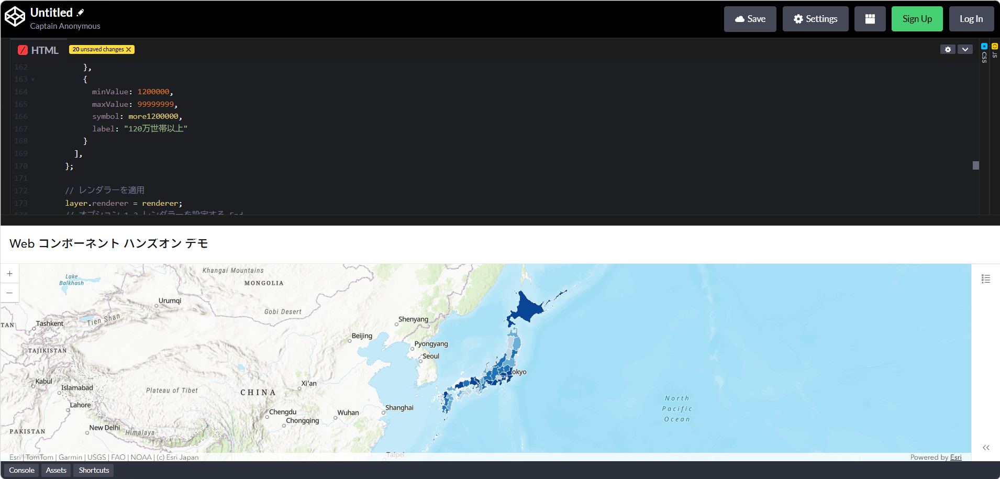
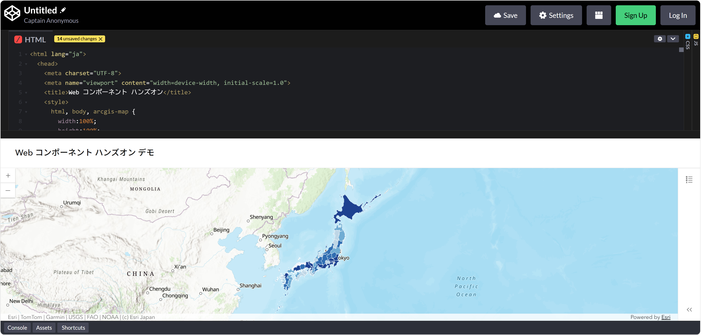

# Web コンポーネントでつくるモダンな地図アプリ開発入門ハンズオン

# 概要
このハンズオンは ArcGIS で使用できる Web コンポーネント（[ArcGIS Maps SDK for JavaScript](https://developers.arcgis.com/javascript/latest/)、[Calcite Design System](https://developers.arcgis.com/calcite-design-system/)）を使用して、Web アプリケーションを作成する流れを紹介します。ハンズオンの各手順で、コメントの「手順 x-x ～ Start 」から「手順 x-x ～ End 」までをコピーし、該当箇所にペーストしてください。（※一部 Start から End による追記ではなくコードの書き換え箇所があります。）

# 準備
## HTML の準備
1. [CodePen](https://codepen.io/pen/?editors=1000) を任意の Web ブラウザーで開きます。

2. `CodePen` の HTML エディターに以下のコードを記述します。

```html
<html lang="ja">
  <head>
    <meta charset="UTF-8">
    <title>Web コンポーネント ハンズオン</title>
    <style>
      html, body {
        width:100%;
        height:100%;
        margin:0;
        padding:0;
      }
    </style>
  </head>
  <body>
    Hello World!

    <script></script>
  </body>
</html>
```



## 手順 1 ： 必要なライブラリーの追加

`ArcGIS Maps SDK for JavaScript` と `Calcite Design System` のライブラリーの参照を追加します。

1. `<head>` タグ内の `</style>` の下に以下のコードを追記します。
```html
    </style>

    <!-- 手順 1-1 Calcite Design System と ArcGIS Maps SDK for JavaScript を使うために必要なライブラリーをロードする。 Start -->
    <!-- CDN から ArcGIS Maps SDK for JavaScript を読み込む -->
    <script type="module" src="https://js.arcgis.com/5.1/"></script>
    <!-- 手順 1-1 Calcite Design System と ArcGIS Maps SDK for JavaScript を使うために必要なライブラリーをロードする。 End -->

  </head>
```

これで Web ページ内で `ArcGIS Maps SDK for JavaScript` と `Calcite Design System` を使用する準備ができました。  
準備ができたらはじめに `ArcGIS Maps SDK for JavaScript` の Web コンポーネントであるマップ コンポーネントを使用してマップを表示していきます。

# ArcGIS Maps SDK for JavaScript のマップ コンポーネントを使用してマップを表示
## 手順 2  : 画面上にマップを表示

`ArcGIS Maps SDK for JavaScript` のマップ コンポーネントを使用して画面上に地図を表示します。

1. `<body>` タグ内の `Hello World!` という文字列を削除し、以下のコードを記入し保存します。

```html
  <body>
    <!-- 手順 2-1 マップ コンポーネントで topo-vector ベースマップで日本を中心で表示。また、マップ上に拡大、縮小ボタンを表示 Start -->
    <arcgis-map id="mapEl" basemap="topo-vector" center="138, 35.5" zoom="5" popup-disabled>
      <arcgis-zoom slot="top-left"></arcgis-zoom>
    </arcgis-map>
    <!-- 手順 2-1 マップ コンポーネントで topo-vector ベースマップで日本を中心で表示。また、マップ上に拡大、縮小ボタンを表示 End -->
    <script></script>
  </body>
```

2. スタイルに `arcgis-map` を追加します。
``` html
    <!-- Before -->
    <!-- 
     html, body {
    -->
    <!-- 手順 2-2 style に arcgis-map を追加 -->
    <!-- After -->
     html, body, arcgis-map {
```


ここでは、[マップ コンポーネント](https://developers.arcgis.com/javascript/latest/references/map-components/)とマップ上に[拡大・縮小ボタン](https://developers.arcgis.com/javascript/latest/references/map-components/arcgis-zoom/)を設定しています。



## 手順 3 : マップ上にフィーチャ レイヤーを追加

表示したマップ上に[フィーチャ レイヤー](https://developers.arcgis.com/javascript/latest/api-reference/esri-layers-FeatureLayer.html)を追加し、さらに任意のフィーチャをクリックした際にアラートを使ってクリックしたフィーチャ情報を表示する処理を追加します。

1. `<body>` タグ内にある `<script>` タグの属性として以下のように `type="module"` を追記します。
```html

    <!-- Before -->
    <!-- 
    <script></script>
    -->
    <!-- After -->
    <!-- 手順 3-1 <script> タグの属性として type="module" を追記する -->
    <script type="module"></script>
  </body>
```
`<script>` タグに `type="module"` を指定すると、そのスクリプトは `ES モジュール`として実行されます。これにより、CDN を使ってモジュールをインポートする際に  `await` 演算子 が使えるようになります。

2. `<script>` タグ内に以下のコードを記述します。

```html
    <script type="module">
      // 手順 3-2 フィーチャ レイヤーのクラスをインポート・使用してマップ上に表示 Start
      const FeatureLayer = await $arcgis.import("@arcgis/core/layers/FeatureLayer.js");
      // arcgis-map 要素の取得
      const arcgisMap = document.querySelector("arcgis-map");

      // FeatureLayer クラスのインスタンスを作成
      const layer = new FeatureLayer({
          portalItem: {
            id: "d473d15a95e1420c96e2063d48720ef3"
          },
          outFields: ["*"]
      });

      // arcgis-map 要素の準備を待つ
      await arcgisMap.componentOnReady();
      
      // レイヤーをマップに追加
      arcgisMap.map.add(layer);

      // arcgis-map 要素をクリックしたタイミングで発火
      arcgisMap.addEventListener("arcgisViewClick", (evt) => {
          // 追加した FeatureLayer のレイヤー ビューを取得
          const layerView = arcgisMap.allLayerViews.items[2];
          // クリックした地点のフィーチャを空間検索するための条件を設定
          const query = layer.createQuery();
          query.geometry = evt.detail.mapPoint;
          query.returnGeometry = false;

          // 取得したレイヤー ビューに対して対象の条件で検索
          layerView.queryFeatures(query)
              .then(result => {
                  // 検索結果をアラートとして表示
                  alert(result.features[0].attributes.KEN);
              });
      });
      // 手順 3-2 フィーチャ レイヤーのクラスをインポート・使用してマップ上に表示 End
    </script>
```

以下のように「[全国都道府県界データ 2025](https://esrij.maps.arcgis.com/home/item.html?id=d473d15a95e1420c96e2063d48720ef3#overview)」のレイヤーが表示され、任意の都道府県フィーチャをクリックすると画面上部にクリックしたフィーチャの情報が表示されます。




ここまでで `ArcGIS Maps SDK for JavaScript` の Web コンポーネントであるマップ コンポーネントを使用して地図を使用したアプリケーションを作成する手順を見てきました。  
ここからは `Calcite Design System` を使用して Web アプリケーションの UI を追加していきます。

# Calcite Design System を使用して Web アプリケーションの UI を構築
## 手順 4 : Calcite コンポーネントで UI 構築およびイベント処理の追加
1. `<body>` タグ内で `<arcgis-map>` タグを囲うように以下のコードを追記します。

```html
  <body>
    <!-- 手順 4-1-1 Calcite Design System の Shell コンポーネントを追加 Start -->
    <!-- Shell コンポーネント -->
    <calcite-shell>
    <!-- 手順 4-1-1 Calcite Design System の Shell コンポーネントを追加 End -->

      <!-- 手順 2-1 マップ コンポーネント： topo-vector ベースマップで日本を中心で表示。また、マップ上に拡大、縮小ボタンを表示 Start -->
      <arcgis-map id="mapEl" basemap="topo-vector" center="138, 35.5" zoom="5" popup-disabled>
        <arcgis-zoom slot="top-left"></arcgis-zoom>
      </arcgis-map>
      <!-- 手順 2-1 マップ コンポーネントで topo-vector ベースマップで日本を中心で表示。また、マップ上に拡大、縮小ボタンを表示 End -->
    <!-- 手順 4-1-2 Calcite Design System の Shell コンポーネントを追加 Start -->
    </calcite-shell>
    <!-- 手順 4-1-2 Calcite Design System の Shell コンポーネントを追加 End --> 

    <!-- 手順 3-1 <script> タグの属性として type="module" を追記する -->
    <script type="module">
```

ここでは、[シェル コンポーネント](https://developers.arcgis.com/calcite-design-system/components/shell/)を追加しています。シェル コンポーネントはアプリケーション全体のレイアウトを構成するための土台となるコンポーネントですが、コンポーネント内にマップ コンポーネント以外の要素が無いためここでの変化はありません。 

2. `<calcite-shell>` タグ内で `<arcgis-map>` タグの上に以下のコードを追記します。

```html
  <!-- 手順 4-1-1 Calcite Design System の Shell コンポーネントを追加 Start -->
  <!-- Shell コンポーネント -->
  <calcite-shell>
  <!-- 手順 4-1-1 Calcite Design System の Shell コンポーネントを追加 End -->

    <!-- 手順 4-2 Shell にヘッダーとメニューを追加 Start -->
    <!-- ヘッダー -->
    <!-- Nabigation コンポーネント -->
    <calcite-navigation slot="header">
      <!-- Nabigation Logo コンポーネント -->
      <calcite-navigation-logo heading="Web コンポーネント ハンズオン デモ" heading-level="3"
        slot="logo">
      </calcite-navigation-logo>
    </calcite-navigation>
    <!-- ヘッダー -->
    <!-- メニュー -->
    <!-- Shell Panel コンポーネント： パネル部分はデフォルトでは非表示 -->
    <calcite-shell-panel slot="panel-end" display-mode="float-content" collapsed>
      <calcite-action-bar slot="action-bar">
        <!-- Action コンポーネント： 押下することで凡例の表示・非表示を行う（処理は後ほど JavaScript にて記述） -->
        <calcite-action data-action-id="legend" icon="legend" text="凡例"></calcite-action>
      </calcite-action-bar>
      <!-- Panel コンポーネント： デフォルトでは非表示 -->
      <calcite-panel heading="凡例" height-scale="l" data-panel-id="legend" closed closable>
        <!-- 凡例コンポーネント： マップに設定されいているレイヤーの凡例を表示する -->
        <arcgis-legend legend-style="classic" reference-element="mapEl"></arcgis-legend>
      </calcite-panel>
    </calcite-shell-panel>
    <!-- メニュー -->
    <!-- 手順 4-2 Shell にヘッダーとメニューを追加 End -->

    <!-- 手順 2-1 マップ コンポーネント： topo-vector ベースマップで日本を中心で表示。また、マップ上に拡大、縮小ボタンを表示 Start -->
    <arcgis-map id="mapEl" basemap="topo-vector" center="138, 35.5" zoom="5" popup-disabled>
      <arcgis-zoom slot="top-left"></arcgis-zoom>
    </arcgis-map>
    <!-- 手順 2-1 マップ コンポーネントで topo-vector ベースマップで日本を中心で表示。また、マップ上に拡大、縮小ボタンを表示 End -->
```

ここでは、ヘッダーの要素、画面右側に[シェル パネル](https://developers.arcgis.com/calcite-design-system/components/shell-panel/)、凡例の表示・非表示を切り替えるための[アクション ボタン](https://developers.arcgis.com/calcite-design-system/components/action/)、シェル パネル上に表示する[パネル](https://developers.arcgis.com/calcite-design-system/components/panel/)、パネル上に表示する[凡例](https://developers.arcgis.com/javascript/latest/references/map-components/arcgis-legend/)が定義されています。

CodePen を更新すると以下のように先ほどのマップだけのデザインに加えて、ヘッダーと右側にシェル パネルの要素が追加されることが分かります。ヘッダーとシェル パネルにはそれぞれ [slot](https://developers.arcgis.com/calcite-design-system/components/shell/#slots) プロパティが設定されており、その値によって表示位置が決まります。また、凡例のアクション ボタンには [icon](https://developers.arcgis.com/calcite-design-system/components/action/#api-reference-properties-icon) プロパティが設定されており Calcite Design System で用意されている[凡例のアイコン](https://developers.arcgis.com/calcite-design-system/icons/?query=legend)を表示しています。



この画面で右側のシェル パネルの凡例アクション ボタンをクリックしてください。何も変化がないことが確認できます。これは Calcite コンポーネントに対してクリックイベントの処理を追加していないためです。次の手順で Calcite コンポーネントにイベント処理を追加して凡例の表示・非表示を動的に変更するようにしていきます。

1. `<script>` タグ内で`手順 3-2` に記述したコードの下に以下のコードを追記します。
```html
    <script type="module">
      // ～～ 中略 ～～
      });
      // 手順 3-2 フィーチャ レイヤーのクラスをインポート・使用してマップ上に表示 End

      // 手順 4-3 各種 Calcite コンポーネントのイベント処理と追加 Start
      // シェル パネル
      const shellPanel = document.querySelector("calcite-shell-panel");
      // 凡例のアクション ボタン
      const legendAction = document.querySelector(`[data-action-id=legend]`);
      // 凡例を表示するパネル
      const legendPanel = document.querySelector(`[data-panel-id=legend]`);
      // 凡例のアクション ボタンをクリックしたイベントを取得して処理を実行
      legendAction.addEventListener("click", () => {
          // 凡例パネルの開閉状態を判定
          if (legendPanel.closed) { // 凡例パネルが閉じている場合
              // シェル パネルを開く
              shellPanel.collapsed = false;
              // 凡例のアクション ボタンをアクティブにする
              legendAction.active = true;
              // 凡例パネルを開く
              legendPanel.closed = false;
          } else { // 凡例パネルが開いている場合
              // シェル パネルを閉じる
              shellPanel.collapsed = true;
              // 凡例のアクション ボタンを非アクティブにする
              legendAction.active = false;
              // 凡例パネルを閉じる
              legendPanel.closed = true;
          }
      });

      // 凡例パネルの閉じるボタンをクリックしたイベントを取得して処理を実行
      legendPanel.addEventListener("calcitePanelClose", () => {
          // 凡例パネルを表示しているシェル パネルを閉じる
          shellPanel.collapsed = true;
          // 凡例のアクション ボタンを非アクティブにする
          legendAction.active = false;
      });
      // 手順 4-3 各種 Calcite コンポーネントのイベント処理と追加 End
    </script>
```

ブラウザーを更新し凡例アクション ボタンをクリックすると以下のように凡例が表示されます。



Calcite コンポーネントにイベント処理を追加することで凡例アクション ボタンをのクリック時に凡例の表示・非表示が切り替わります。また、凡例の上部にある閉じる（×）ボタンをクリックした際にも非表示になります。

凡例アクション ボタンの[クリック イベント](https://developer.mozilla.org/ja/docs/Web/API/Element/click_event)は一般的な HTML のイベントを取得していますが、凡例を表示している凡例パネルの閉じる（×）ボタンのクリック イベントは Calcite コンポーネント（[パネル コンポーネント](https://developers.arcgis.com/calcite-design-system/components/panel/#events)）独自のイベントを取得して処理をしています。

# 表示色の変更
先ほど表示した都道府県界データは一色で表示されていました。
この章では属性値に応じて表示される色を変えてみましょう。ここでは世帯数の属性値に応じて変更します。


ArcGIS Maps SDK for JavaScript では見た目を表すシンボルと属性値に応じてどのシンボルを用いるかを制御するレンダラーを定義し、レイヤーに適用することで表示色が変更できます。
シンボルの設定から順に進めます。


## 手順 5 :  シンボルとレンダラーの定義と適用
## シンボルの定義
表示の方法を変えるために、まず塗りつぶしの色や輪郭線の幅、透明度などグラフィックの見た目を表すシンボルを定義します。
今回は薄い青色から濃い青色にかけて複数のシンボルを定義します。


```html
      // 手順 3-2 フィーチャ レイヤーのクラスをインポート・使用してマップ上に表示 Start
      const FeatureLayer = await $arcgis.import("@arcgis/core/layers/FeatureLayer.js");
      // arcgis-map 要素の取得
      const arcgisMap = document.querySelector("arcgis-map");

      // FeatureLayer クラスのインスタンスを作成
      const layer = new FeatureLayer({
          url: "https://services.arcgis.com/wlVTGRSYTzAbjjiC/arcgis/rest/services/ZENKOKU_PREF_view/FeatureServer",
          outFields: ["*"]
      });

      // 手順 5-1 シンボルを定義する Start

      // 各階級に使うシンボルを定義
       const less300000 = {
        type: "simple-fill", 
        color: [239,243,255,1],
        style: "solid",
        outline: {
          width: 0.25,
          color: [0, 0, 0, 1],
        },
      };
      const less500000 = {
        type: "simple-fill", 
        color: [189,215,231,1],
        style: "solid",
        outline: {
          width: 0.25,
          color: [0, 0, 0, 1],
        },
      };
      const less800000 = {
        type: "simple-fill", 
        color: [107,174,214,1],
        style: "solid",
        outline: {
          width: 0.25,
          color: [0, 0, 0, 1],
        },
      };
      const less1200000 = {
        type: "simple-fill", 
        color: [33,113,181,1],
        style: "solid",
        outline: {
          width: 0.25,
          color: [0, 0, 0, 1],
        },
      };
      const more1200000 = {
        type: "simple-fill",
        color: [8,69,148,1],
        style: "solid",
        outline: {
          width: 0.25,
          color: [0, 0, 0, 1],
        },
      };
      const defaultSym = {
        type: "simple-fill", 
        color: "black",
        style: "backward-diagonal",
        outline: {
          width: 0.25,
          color: [50, 50, 50, 1],
        },
      };
      // 手順 5-1 シンボルを定義する End
      
      // arcgis-map 要素の準備を待つ
      await arcgisMap.componentOnReady();
      
      // レイヤーをマップに追加
      arcgisMap.map.add(layer);

```

## レンダラーの適用
レンダラーはレイヤー内のグラフィックに使用される一連のシンボルを定義します。レンダラーを使用することで、レイヤーが持つ特定の属性に基づいてフィーチャを色やサイズの異なるシンボルで表現することができます。
定義したシンボルを利用して[数値分類レンダラー (ClassBreaksRenderer)](https://community.esri.com/home/leaving?allowTrusted=1&target=https%3A%2F%2Fdevelopers.arcgis.com%2Fjavascript%2Flatest%2Fapi-reference%2Fesri-renderers-ClassBreaksRenderer.html) を設定し、レイヤーに適用してみましょう。

```html
      const more1200000 = {
        type: "simple-fill",
        color: "#084594",
        style: "solid",
        outline: {
          width: 0.5,
          color: [255, 255, 255, 0.5],
        },
      };
      // 手順 5-1 シンボルを定義する End

      // 手順 5-2 レンダラーの設定 Start
      const renderer = {
        type: "class-breaks", 
        field: "H_NUM", 
        defaultSymbol: defaultSym,
        defaultLabel: "no data",
        classBreakInfos: [
          {
            minValue: 0,
            maxValue: 300000,
            symbol: less300000,
            label: "30万世帯未満",
          },
          {
            minValue: 300000,
            maxValue: 500000,
            symbol: less500000,
            label: "30万世帯～50万世帯",
          },
          {
            minValue: 500000,
            maxValue: 800000,
            symbol: less800000,
            label: "50万世帯～80万世帯"
          },
          {
            minValue: 800000,
            maxValue: 1200000,
            symbol: less1200000,
            label: "80万世帯～120万世帯"
          },
          {
            minValue: 1200000,
            maxValue: 99999999,
            symbol: more1200000,
            label: "120万世帯以上"
          }
        ],
      };

      // レンダラーを適用
      layer.renderer = renderer;
      // 手順 5-2 レンダラーを設定する End

      // arcgis-map 要素の準備を待つ
      await arcgisMap.componentOnReady();
      
      // レイヤーをマップに追加
      arcgisMap.map.add(layer);

```




# Calcite コンポーネントのデザインを変更

## オプション 1 : ヘッダーの背景色を変更
1. `<style>` タグ内に新しいスタイル ルールを追記します。

```html
    <style>
      /** ～～ 中略 ～～ */
      }
      /* オプション 1  calcite-navigation 要素のヘッダー背景色を変更する Start */
      calcite-navigation {
        --calcite-navigation-background-color: yellow;
      }
      /* オプション 1  calcite-navigation 要素のヘッダー背景色を変更する End */
    </style>
```
CodePen を更新すると以下のようにヘッダー部分の背景色が変更されているのが確認できます。



パネル コンポーネントに設定されている [CSS 変数](https://developers.arcgis.com/calcite-design-system/components/panel/#styles)を用いることでコンポーネントのデザインを変更することができます。このように Calcite コンポーネントのデザインを CSS 変数を用いることで変更することができます。

今回ご用意した手順は以上になります。ここまでのの手順を完了すると以下のソースコードになります。
```html
<html lang="ja">
  <head>
    <meta charset="UTF-8">
    <title>Web コンポーネント ハンズオン</title>
    <style>
      html, body, arcgis-map {
        width:100%;
        height:100%;
        margin:0;
        padding:0;
      }
      /* オプション 1  calcite-navigation 要素のヘッダー背景色を変更する Start */
      calcite-navigation {
        --calcite-navigation-background-color: yellow;
      }
      /* オプション 1  calcite-navigation 要素のヘッダー背景色を変更する End */
    </style>
        <!-- 手順 1-1 Calcite Design System と ArcGIS Maps SDK for JavaScript を使うために必要なライブラリーをロードする。 Start -->
    <!-- CDN から ArcGIS Maps SDK for JavaScript を読み込む -->
    <script type="module" src="https://js.arcgis.com/5.1/"></script>
    <!-- 手順 1-1 Calcite Design System と ArcGIS Maps SDK for JavaScript を使うために必要なライブラリーをロードする。 End -->
  </head>
  <body>
    <!-- 手順 4-1-1 Calcite Design System の Shell コンポーネントを追加 Start -->
    <!-- Shell コンポーネント -->
    <calcite-shell>
    <!-- 手順 4-1-1 Calcite Design System の Shell コンポーネントを追加 End -->
    <!-- 手順 4-2 Shell にヘッダーとメニューを追加 Start -->
    <!-- ヘッダー -->
    <!-- Nabigation コンポーネント -->
    <calcite-navigation slot="header">
      <!-- Nabigation Logo コンポーネント -->
      <calcite-navigation-logo heading="Web コンポーネント ハンズオン デモ" heading-level="3"
        slot="logo">
      </calcite-navigation-logo>
    </calcite-navigation>
    <!-- ヘッダー -->
    <!-- メニュー -->
    <!-- Shell Panel コンポーネント： パネル部分はデフォルトでは非表示 -->
    <calcite-shell-panel slot="panel-end" display-mode="float-content" collapsed>
      <calcite-action-bar slot="action-bar">
        <!-- Action コンポーネント： 押下することで凡例の表示・非表示を行う（処理は後ほど JavaScript にて記述） -->
        <calcite-action data-action-id="legend" icon="legend" text="凡例"></calcite-action>
      </calcite-action-bar>
      <!-- Panel コンポーネント： デフォルトでは非表示 -->
      <calcite-panel heading="凡例" height-scale="l" data-panel-id="legend" closed closable>
        <!-- 凡例コンポーネント： マップに設定されいているレイヤーの凡例を表示する -->
        <arcgis-legend legend-style="classic" reference-element="mapEl"></arcgis-legend>
      </calcite-panel>
    </calcite-shell-panel>
    <!-- メニュー -->
    <!-- 手順 4-2 Shell にヘッダーとメニューを追加 End -->
    <!-- 手順 2-1 マップ コンポーネントで topo-vector ベースマップで日本を中心で表示。また、マップ上に拡大、縮小ボタンを表示 Start -->
    <arcgis-map id="mapEl" basemap="topo-vector" center="138, 35.5" zoom="5" popup-disabled>
      <arcgis-zoom slot="top-left"></arcgis-zoom>
    </arcgis-map>
    <!-- 手順 2-1 マップ コンポーネントで topo-vector ベースマップで日本を中心で表示。また、マップ上に拡大、縮小ボタンを表示 End -->
    <!-- 手順 4-1-2 Calcite Design System の Shell コンポーネントを追加 Start -->
    </calcite-shell>
    <!-- 手順 4-1-2 Calcite Design System の Shell コンポーネントを追加 End --> 
    <!-- 手順 3-1 <script> タグの属性として type="module" を追記する -->
    <script type="module">
            // 手順 3-2 フィーチャ レイヤーのクラスをインポート・使用してマップ上に表示 Start
      const FeatureLayer = await $arcgis.import("@arcgis/core/layers/FeatureLayer.js");
      // arcgis-map 要素の取得
      const arcgisMap = document.querySelector("arcgis-map");

      // FeatureLayer クラスのインスタンスを作成
      const layer = new FeatureLayer({
          portalItem: {
            id: "d473d15a95e1420c96e2063d48720ef3"
          },
          outFields: ["*"]
      });
      
      // 手順 5-1 シンボルを定義する Start

      // 各階級に使うシンボルを定義
       const less300000 = {
        type: "simple-fill", 
        color: [239,243,255,1],
        style: "solid",
        outline: {
          width: 0.25,
          color: [0, 0, 0, 1],
        },
      };
      const less500000 = {
        type: "simple-fill", 
        color: [189,215,231,1],
        style: "solid",
        outline: {
          width: 0.25,
          color: [0, 0, 0, 1],
        },
      };
      const less800000 = {
        type: "simple-fill", 
        color: [107,174,214,1],
        style: "solid",
        outline: {
          width: 0.25,
          color: [0, 0, 0, 1],
        },
      };
      const less1200000 = {
        type: "simple-fill", 
        color: [33,113,181,1],
        style: "solid",
        outline: {
          width: 0.25,
          color: [0, 0, 0, 1],
        },
      };
      const more1200000 = {
        type: "simple-fill",
        color: [8,69,148,1],
        style: "solid",
        outline: {
          width: 0.25,
          color: [0, 0, 0, 1],
        },
      };
      const defaultSym = {
        type: "simple-fill", 
        color: "black",
        style: "backward-diagonal",
        outline: {
          width: 0.25,
          color: [50, 50, 50, 1],
        },
      };
      // 手順 5-1 シンボルを定義する End
      
      // 手順 5-2 レンダラーの設定 Start
      const renderer = {
        type: "class-breaks", 
        field: "H_NUM", 
        defaultSymbol: defaultSym,
        defaultLabel: "no data",
        classBreakInfos: [
          {
            minValue: 0,
            maxValue: 300000,
            symbol: less300000,
            label: "30万世帯未満",
          },
          {
            minValue: 300000,
            maxValue: 500000,
            symbol: less500000,
            label: "30万世帯～50万世帯",
          },
          {
            minValue: 500000,
            maxValue: 800000,
            symbol: less800000,
            label: "50万世帯～80万世帯"
          },
          {
            minValue: 800000,
            maxValue: 1200000,
            symbol: less1200000,
            label: "80万世帯～120万世帯"
          },
          {
            minValue: 1200000,
            maxValue: 99999999,
            symbol: more1200000,
            label: "120万世帯以上"
          }
        ],
      };

      // レンダラーを適用
      layer.renderer = renderer;
      // 手順 5-2 レンダラーを設定する End

      // arcgis-map 要素の準備を待つ
      await arcgisMap.componentOnReady();
      
      // レイヤーをマップに追加
      arcgisMap.map.add(layer);

      // arcgis-map 要素をクリックしたタイミングで発火
      arcgisMap.addEventListener("arcgisViewClick", (evt) => {
          // 追加した FeatureLayer のレイヤー ビューを取得
          const layerView = arcgisMap.allLayerViews.items[2];
          // クリックした地点のフィーチャを空間検索するための条件を設定
          const query = layer.createQuery();
          query.geometry = evt.detail.mapPoint;
          query.returnGeometry = false;

          // 取得したレイヤー ビューに対して対象の条件で検索
          layerView.queryFeatures(query)
              .then(result => {
                  // 検索結果をアラートとして表示
                  alert(result.features[0].attributes.KEN);
              });
      });
      // 手順 3-2 フィーチャ レイヤーのクラスをインポート・使用してマップ上に表示 End
            // 手順 4-3 各種 Calcite コンポーネントのイベント処理と追加 Start
      // シェル パネル
      const shellPanel = document.querySelector("calcite-shell-panel");
      // 凡例のアクション ボタン
      const legendAction = document.querySelector(`[data-action-id=legend]`);
      // 凡例を表示するパネル
      const legendPanel = document.querySelector(`[data-panel-id=legend]`);
      // 凡例のアクション ボタンをクリックしたイベントを取得して処理を実行
      legendAction.addEventListener("click", () => {
          // 凡例パネルの開閉状態を判定
          if (legendPanel.closed) { // 凡例パネルが閉じている場合
              // シェル パネルを開く
              shellPanel.collapsed = false;
              // 凡例のアクション ボタンをアクティブにする
              legendAction.active = true;
              // 凡例パネルを開く
              legendPanel.closed = false;
          } else { // 凡例パネルが開いている場合
              // シェル パネルを閉じる
              shellPanel.collapsed = true;
              // 凡例のアクション ボタンを非アクティブにする
              legendAction.active = false;
              // 凡例パネルを閉じる
              legendPanel.closed = true;
          }
      });

      // 凡例パネルの閉じるボタンをクリックしたイベントを取得して処理を実行
      legendPanel.addEventListener("calcitePanelClose", () => {
          // 凡例パネルを表示しているシェル パネルを閉じる
          shellPanel.collapsed = true;
          // 凡例のアクション ボタンを非アクティブにする
          legendAction.active = false;
      });
      // 手順 4-3 各種 Calcite コンポーネントのイベント処理と追加 End
    </script>
  </body>
</html>
```

# さいごに 
このように ArcGIS では GIS 要素の Web コンポーネントとデザイン要素の Web コンポーネントが用意されています。これらを使うことで比較的容易に独自の Web アプリケーションを作成できます。Web アプリケーション開発に興味のある方は是非 ArcGIS で使用できる Web コンポーネントを活用して開発をしてみてください！
